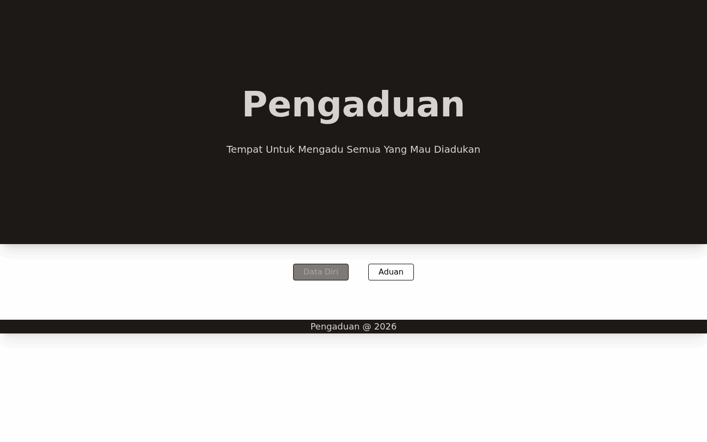
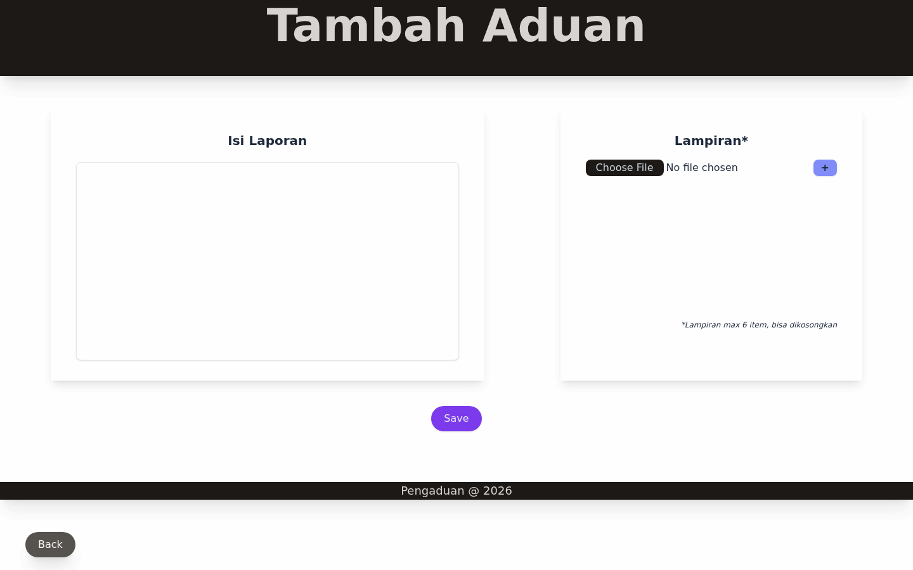
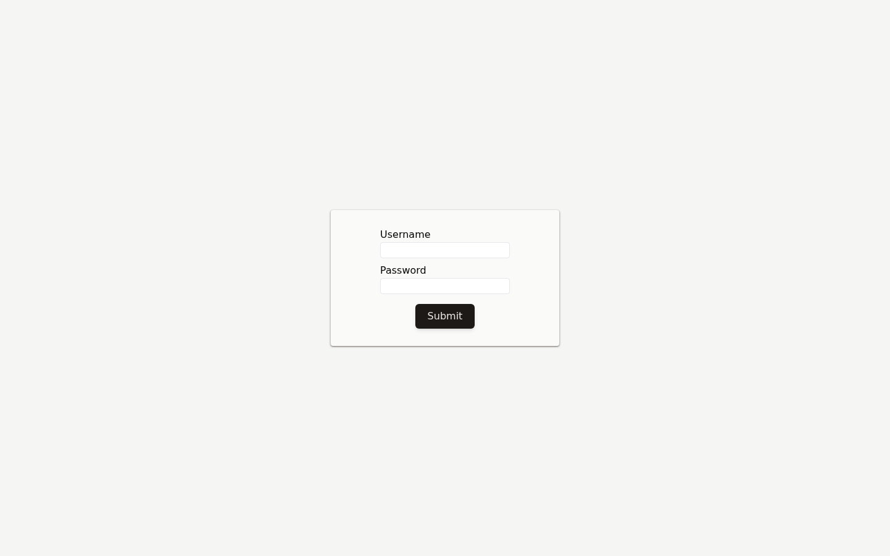

# Pengaduan

Pengaduan is an Indonesian-language complaints desk for the public. Residents lodge a
`pengaduan` with their details and up to six attachments, then follow it as it moves
through `belumVerif`, `proses`, and `selesai`. Petugas (staff) work the other side: they
verify incoming complaints, write `tanggapan` responses, and administer user accounts.

It replaces the paper trail between a service counter and a back office with one shared
queue. Public pages need no account; the staff side sits behind a login.



The page chrome is real, but the Aduan list has no rows here: the companion API was not
running when this was captured, and every complaint row comes from that API.

## What you can do

Anyone can lodge and follow a complaint without an account:

- Submit a `pengaduan` with a report, personal details, and up to six attachments at
  `/pengaduan/add`.
- Browse complaints from the landing page at `/` and open one at `/pengaduan/:id` to read
  its `isiLaporan`, attachments, and `tanggapan`.
- Edit or delete your own complaint from its detail page at `/pengaduan/:id`.

The submission form asks for "Isi Laporan" and an optional "Lampiran" (up to six items)
before saving:



Staff sign in to work the queue:

- Sign in at `/admin/login` to reach the protected admin pages.
- See Pengaduan, Members, and Users counts on the dashboard at `/admin`, and the
  searchable all-complaints table at `/admin/pengaduan`.
- Verify a complaint, write or edit `tanggapan`, change its status, and handle attachments
  at `/admin/pengaduan/:id`.
- Look up a member and that member's complaints at `/admin/members` and
  `/admin/members/detail`.
- Add, edit, and remove staff users and their roles at `/admin/users`,
  `/admin/users/add`, `/admin/users/:id`, and `/admin/users/edit/:id`.



## How it works

Pages are rendered on a Node server that also serves the browser assets; the image has no
separate web server. There is no database in this repository: every read and write goes
through a companion API over `/api/*`.

The server rewrites `/api/*` to the address in `API_URL`. That address is read when the
server starts, not baked into the build, so the same build can point at different API
deployments by changing `API_URL` at runtime. That is the integration point to get right
when deploying; a missing or wrong `API_URL` renders the page chrome without any data.

## Running it

```bash
yarn install --frozen-lockfile
yarn build
yarn start
```

`yarn build` produces a `.nuxt/` directory with the server and client bundles, not a
`dist/` folder. `API_URL` must point at a running `Solo/api-pengaduan` instance. The server
listens on `PORT`, which the container sets to `8080`.

## Limitations

Every data-driven screen depends on the companion API. With it unavailable the landing
page renders its hero and tabs but no complaints, and the admin pages cannot load their
counts.

The axios error handler reads `err.response.status` (`plugins/axios.js:4-9`), so a
connection-level failure with no response object throws a `TypeError` instead of showing a
message. Any axios error also opens a modal alert that can cover the page.

There is no registration or password reset in this frontend, and no local data or fixtures
to fall back on. The complaint lists, detail pages, and admin screens were described from
page components and API calls in source; they were not verified against a live API.

Developer notes, exact versions, and operational risks are in [TECHNICAL.md](TECHNICAL.md).
